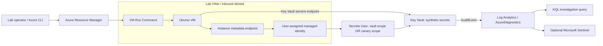

# AzureSecLab

**Attack, observe, and harden Azure managed identity permissions.** A reproducible cloud identity lab by Bahaeddine Melki, Telecommunications Engineer specialized in Cybersecurity.

Day-one scenario: an application VM has vault-wide secret access. From an authorized execution session, its managed identity can read an unrelated synthetic payroll secret. Remediation narrows its role to the application canary secret. A read-only probe checks both targets; Key Vault diagnostics provide independent investigation evidence.

**Status:** offline implementation. No Azure resources have been deployed and no live Sentinel incident is claimed. Sample reports are explicitly synthetic. Azure subscription access, a spending limit, SKU availability, a real plan and before/after telemetry validation are required to complete the cloud lab.

## Architecture



The VM has an explicit Standard public IP for outbound connectivity; its NSG denies all inbound traffic, including SSH. Administration uses Azure Run Command. Key Vault uses RBAC and a default-deny firewall allowing the workload subnet and your operator IPv4. This is network restriction, not Private Link. Outbound VM traffic remains permitted for the agent and package services.

## Try the offline demonstration

Python 3.11+; no packages or Azure credentials required:

```powershell
python -m unittest discover -s tests -v
python -m scripts.report --input examples/vulnerable.json --output reports/vulnerable.html
python -m scripts.report --input examples/hardened.json --output reports/hardened.html
Start-Process reports/hardened.html
```

The reports use the shared Obsidian Signal red/black palette and retain evidence provenance. `scripts.report` exits 1 for an unexpected access pattern. Fixtures demonstrate report behavior, not cloud connectivity.

## Deploy and run the real scenario

Read [the runbook](docs/RUNBOOK.md) and [the threat model](docs/THREAT_MODEL.md) first. Terraform 1.16.x, Azure CLI, an isolated subscription/resource group, and permission to create resources and role assignments are required. AzureRM is pinned to 5.8.0; the provider lock file is committed.

There are three stages: provision the default hardened base with no workload secret role; seed two public synthetic values using Azure CLI; then explicitly enable the workload role. Secrets are deliberately created outside Terraform so their values never enter Terraform state.

| Mode | Canary secret | Payroll secret | Interpretation |
|---|---|---|---|
| Base, `secrets_seeded=false` | Denied | Denied | Infrastructure ready; scenario not enabled |
| Vulnerable, seeded | 200 | 200 | Identity has excessive data-plane scope |
| Hardened, seeded | 200 | 403 | Expected least-privilege access pattern |

A 403 alone does not prove remediation: verify the reason in cloud logs and retain a successful canary read. RBAC propagation may delay results.

## Project contents

- `infra/`: VNet, NSG, VM, managed identity, Key Vault, scoped role, diagnostics and optional Sentinel onboarding.
- `scripts/`: synthetic secret seeding, token-safe VM probe, HTML evidence reporting.
- `detections/`: identity-filtered KQL hunting query and analytic proposal.
- `examples/`: labeled synthetic fixtures and HTML example reports.
- `tests/`: positive, negative, malformed-evidence and script-injection checks.
- `docs/`: deployment, manual acceptance, cleanup, threat model and learning notes.

CI performs offline validation only and never authenticates to Azure. No scheduled deployment or cloud credentials are configured. The known account billing restriction affecting GitHub Actions may prevent hosted jobs from starting; local checks remain separate.

## Cost and scope

This is **not guaranteed free**. VM compute, OS disk, public IPv4, Key Vault operations, Log Analytics ingestion and optional Sentinel can incur charges. The workspace daily cap is not a spending cap and can interrupt telemetry. Azure budgets alert rather than stop resources. Use the Azure pricing calculator for your region and subscription, agree a lab limit, and destroy resources after collecting evidence. Deallocating the VM still leaves billable resources.

Purge protection retains the soft-deleted vault name for seven days; choose a new prefix for an immediate rebuild. Do not disable that protection just to simplify demonstrations.

Windows/Sysmon, Storage, Defender plans, tenant-level Entra role experiments and automatically deployed Sentinel analytics are future scenarios, not features of this first milestone. No LLM is needed to prove the access-control issue.

## References

- [Azure Key Vault logging](https://learn.microsoft.com/en-us/azure/key-vault/general/logging)
- [Enable Key Vault diagnostics](https://learn.microsoft.com/en-us/azure/key-vault/general/howto-logging)
- [Azure explicit outbound connectivity](https://learn.microsoft.com/en-us/azure/virtual-network/ip-services/default-outbound-access)
- [Key Vault Azure RBAC](https://learn.microsoft.com/en-us/azure/key-vault/general/rbac-guide)
- [AzureRM provider source](https://github.com/hashicorp/terraform-provider-azurerm)
